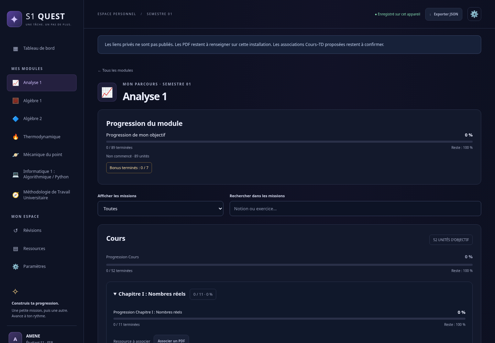

# Livraison des phases A et B

Branche locale : `feature/s1-quest-study-rpg`. La référence `main` reste inchangée. Aucun push, fusion, déploiement, envoi de PDF à un fournisseur ou activation payante.

## Phase A livrée

Audit du dépôt existant, sauvegarde privée complète vérifiée et référence de 67 tests réussis. Commit de préservation : `ff1a405` (`chore: preserve existing site and validate phase A baseline`). Voir [phase-a-audit.md](phase-a-audit.md).

## Phase B livrée

Le programme fourni est intégré : 454 feuilles dans six modules documentés, plus Méthodologie vide. Chapitres et séries regroupent les missions sans compter comme tâches supplémentaires. La progression, les maîtrises, bonus, filtres, propositions Cours–TD et sources privées fonctionnent sans backend.

Les données sont séparées du catalogue. Migration 1/2→3 protégée, historique des anciennes validations conservé, masquages antérieurs respectés, titres personnalisés préservés. Import/export avec confirmation et copie de secours vérifiée ; aucun rapprochement implicite par titre. Les calculs distinguent les espaces d’IDs personnels et académiques, y compris si deux IDs ont le même texte.

Les versions de schéma et choix sur les dix TP bonus sont documentés dans [validation-academique.md](validation-academique.md), sans modification silencieuse du JSON source.

## Fichiers de cette phase

| Fichiers | Rôle |
| --- | --- |
| `curriculum.json` | Catalogue utilisateur exact, sans URLs privées |
| `curriculum.schema.json` | Schéma public pour validation du catalogue source |
| `js/microcurriculum.js` | Normalisation, projection des feuilles, bonus, états, recommandations et compatibilité des ressources |
| `script.js` | Migration protégée, statistiques, import, intégration des groupes/missions, révisions et ressources |
| `index.html`, `style.css` | Chargement du helper et styles responsive des missions/accordéons/filtres |
| `tests/core.test.cjs`, `tests/migration.test.cjs`, `tests/curriculum.test.cjs` | Régressions de logique et compatibilité adaptées au schéma 3 |
| `tests/browser.cjs` | 18 scénarios de régression existants conservés et adaptés |
| `tests/microcurriculum.test.cjs`, `tests/microbrowser.cjs` | Nouveaux tests de logique et interactions Phase B |
| `README.md`, `TESTS.md` | Utilisation, protection des données, commandes et résultats réels |
| `docs/validation-academique.md`, ce rapport | Décisions, limites et périmètre livré |
| `docs/screenshots/*.png` | Captures réelles, sans liens privés |
| `docs/phase-b-test-results.txt` | Journal de l’exécution finale des 112 tests |

Les fichiers antérieurs `js/curriculum.js`, `data/curriculum-legacy.json`, `.gitignore` et `docs/phase-a-audit.md` restent présents. Le fichier local `curriculum.links.local.json` n’est pas versionné et ne doit pas être publié.

## Tests et résultat

**112 PASS / 0 FAIL**, aucune désactivation ni test ignoré, lors de l’exécution finale combinée. [Rapport complet](../TESTS.md), avec commandes et limites. Le site publié et les vrais PDF ne sont pas déclarés testés.

## Prévisualisation et essai manuel

Sur l’ordinateur contenant les fichiers :

```sh
cd S1-QUEST
python3 -m http.server 8000 --bind 127.0.0.1
```

Saisir `http://127.0.0.1:8000` dans le navigateur de ce même ordinateur. Le serveur port 8000 a aussi été démarré et vérifié dans le cloud ; son localhost ne donne pas automatiquement accès depuis votre PC. Aucun aperçu interactif externe n’est disponible ici.

1. Ouvrir Analyse 1, puis « Chapitre II : Suites numériques » : les petites missions suivent l’ordre du catalogue.
2. Choisir « Je commence », puis « À revoir » ou « Maîtrisé » ; constater que seule une action sur la case valide l’achèvement.
3. Cocher une unité : Cours, module et S1 changent ; les TD restent indépendants.
4. Utiliser le TD proposé, puis cocher un exercice : le cours reste inchangé. Recharger conserve les choix.
5. Terminer un bonus : le compteur bonus augmente sans pénaliser l’objectif principal. L’inclusion explicite permet de l’ajouter à cet objectif.
6. Associer un vrai lien Google Drive autorisé depuis « Associer un PDF » ou importer le fichier privé dans Paramètres. L’ouverture dépend de vos droits Google ; aucune permission n’est modifiée.
7. Exporter JSON, apporter une modification, puis importer l’export : vérifier l’aperçu et saisir `IMPORTER`. L’état remplacé reste dans une copie brute locale.

## Captures

Les captures proviennent de Chromium sur les fichiers livrés, avec le fichier de liens privés bloqué. Un profil de test neuf affiche naturellement 0 unité terminée ; il ne représente pas les données de l’utilisateur sur GitHub Pages.

[Dashboard complet](screenshots/dashboard-phase-b.png) · [Analyse 1](screenshots/analyse-phase-b.png) · [Mobile](screenshots/mobile-phase-b.png)



## Suite

La phase C (XP, rangs, succès et quêtes) et la phase D (assistant simulé) ne sont pas implémentées dans cette livraison A/B. La phase E réelle restera soumise aux accords séparés sur les documents, accès, coûts et déploiement.

Message possible pour reprendre : « Continue avec la Phase C sur la branche feature/s1-quest-study-rpg, en conservant la Phase B et toutes les données. Ne publie rien et n’active aucun service payant. »

Les instructions de démarrage ont été enregistrées dans le brouillon de configuration de l’environnement (`start_skill`). Cet enregistrement n’exécute rien et ne publie pas l’environnement ; une éventuelle activation future passe par sa revue/enregistrement dans les paramètres puis la publication de l’environnement par l’utilisateur. Aucun changement d’accès réseau ni secret n’a été demandé.
